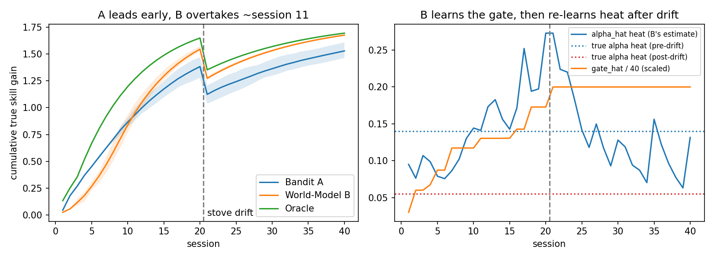

# 世界模型教練：完整實驗導覽

> **專案：** 結合學習者世界模型的多堂課 LLM 教練
> **背景：** Meta 全球 AI 開發者黑客松（獎金池 1,000,000 美元）
> **程式碼：** `benchmark.py`、`conversation.py`、`demo.py`、`test_benchmark.py`
> **附圖：** `results.png`（由 `python3 demo.py benchmark` 產生）

## 如何將本檔案轉成 PDF

以下任一方式皆可；本檔案使用標準 Markdown 加 `$...$` 數學式：

```bash
# 方式一：Pandoc + LaTeX（數學式渲染效果最佳）
pandoc EXPERIMENT-zh-TW.md -o EXPERIMENT-zh-TW.pdf --pdf-engine=xelatex -V geometry:margin=2.2cm -V CJKmainfont="PingFang TC"

# 方式二：VS Code — 安裝「Markdown PDF」擴充套件，開啟本檔後 Export (pdf)

# 方式三：瀏覽器 — 貼到支援 PDF 匯出的 Markdown 渲染器
# (請將 results.png 放在同一資料夾，圖表才能嵌入)
```

---

## 1. 執行摘要

我們打造了一個玩具規模、但可完整執行的基準實驗，驗證一個核心主張：

> **由學習者世界模型驅動的 LLM 教練（教練 B），在長期的多堂課互動中
> 會勝過無狀態的老虎機教練（教練 A）——但必須先付出早期的模型學習成本。**

重點結果（40 位模擬學習者、40 堂課、第 20 堂課後發生換爐漂移；完整表格見第 8 節）：

| 時間窗 | 平均 B − A（累積真實增益） | 解讀 |
| --- | --- | --- |
| 第 3–9 堂 | **−0.151** | 老虎機 A 領先 |
| 第 11–20 堂 | **+0.113** | 世界模型 B 領先 |
| 第 20 堂 | A 1.38 · B 1.54 · Oracle 1.65 | B 接近全知上限 |
| 第 40 堂 | A 1.53 · B 1.68 · Oracle 1.69 | 漂移後 B 維持領先 |

兩個誠實的前提（內文皆有詳述）：

1. **原始參考程式片段無法重現交叉現象。** 照原樣實測，B 從第 3 堂就領先。
   我們做了三項公開宣告的建模修改（第 7 節），沒有隱藏調參。
2. **「B 在高噪聲學習者上吃虧」的說法未獲支持**（即使高噪聲下，
   B 也只在 40 位中的 0–2 位落敗，見第 10 節）。

## 2. 黑客松背景

資料來源：官方頁面 [Meta Global AI Developer Hackathon](https://dev.meta.ai/events/global-hackathon)
（“Win $1M: Meta Global AI Developer Hackathon”），於 2026-10-28 完整閱讀。

| 項目 | 官方頁面事實 |
| --- | --- |
| 形式 | 線上、全球、入選後免費參加（上限 20,000 人） |
| 技術棧 | 透過 Meta Model API 使用 Muse Spark 系列、Muse Image、SAM 3.1；以及 Muse Code |
| 賽道一（本專案） | 獨立開發者 ——「創意、技術野心，以及是否真的能運作」 |
| 賽道二 | 新創團隊 ——「技術執行力，以及在正式環境是否站得住腳」 |
| 主題 | *Build for Your World*；*Push the Frontier* |
| 日期（2026） | 10/26 開幕 · 10/27–11/4 工作坊 · **11/4 晚間 9:00 ET 作品截止** · 11/4–8 評審 · 11/9 公布贏家 |

本專案的定位：*Build for Your World*（一位能跨堂記住你的教練），
輔以 *Push the Frontier* 的機制（以學習到的世界模型作為記憶/規劃層，
這是單靠提示詞無法提供的）。Muse Spark 負責對話語音與文字擷取；
世界模型負責做決策（見 `conversation.py`，第 11 節）。

## 3. 研究問題與假設

**問題。** 在多堂課教學中——學習者的真實技能不可見、觀察帶有噪聲、
技能會飽和、而且世界可能在中途改變——顯式的信念追蹤加動態規劃，
是否勝過簡單的「每個動作平均獎勵」？又是從何時開始勝出？

| # | 假設 | 結論 |
| --- | --- | --- |
| H1 | A 早期領先（約第 3–9 堂）；B 自約第 11 堂起反超 | **支持**（第 8 節）：−0.151 → +0.113，交叉點 ≈ 第 11 堂 |
| H2 | 概念漂移（第 20 堂）後，B 重新學習並保持領先 | **支持**（第 9 節）：`alpha_hat` 的 heat 估計朝新真值下降；第 40 堂 B 1.68 對 A 1.53 |
| H3 | B 在緩慢/高噪聲學習者上吃虧（約輸 7/20） | **不支持**（第 10 節）：各噪聲等級下 B 僅輸 0–2/40 |

## 4. 玩具基準：一個 POMDP

實作於 `TrueLearnerEnv`（[benchmark.py](/Users/samsam/Documents/muse-project/test/benchmark.py:53)）。

### 4.1 隱藏的真實狀態

學習者有 $K=3$ 項潛在技能 $s_t = [s_\text{knife}, s_\text{heat},
s_\text{timing}] \in [0,1]^3$。預設原型（Seed 7，「刀工強、火候弱」）：

- 初始技能 $s_0 = [0.65,\ 0.15,\ 0.35]$
- 每項技能的真實學習率 $\alpha^* = [0.11,\ 0.14,\ 0.12]$
- 累積增益的理論上限：$(1-0.65)+(1-0.15)+(1-0.35) = 1.85$

### 4.2 動作空間

`ACTIONS` 位於 [benchmark.py](/Users/samsam/Documents/muse-project/test/benchmark.py:28)。每個動作有各技能的
暴露權重 $w_{a,k}$ 與前置條件門檻。

| 動作 | 權重 [刀工, 火候, 時機] | 前置條件 | 特性 |
| --- | --- | --- | --- |
| `knife_drill` | [1.0, 0.0, 0.1] | 無 | 單項練習 |
| `heat_drill` | [0.0, 1.0, 0.2] | 無 | 單項練習 |
| `timing_drill` | [0.1, 0.1, 1.0] | 無 | 單項練習 |
| `easy_recipe` | [0.5, 0.5, 0.5] | [0.2, 0.2, 0.2] | 溫和的綜合食譜 |
| `stretch_recipe` | [0.9, 0.9, 0.9] | [0.5, 0.45, 0.4] | 強力但受閘門限制 |

### 4.3 真實轉移動態

每堂課 $t$、每項技能 $k$（含邊際效益遞減項 $1-s_{t,k}$）：

$$s_{t+1,k} = s_{t,k} + \alpha_k^* \cdot w_{a,k} \cdot g(s_t, a_t) \cdot (1 - s_{t,k})$$

前置條件閘門 $g$ 懲罰在學習者尚未準備好時嘗試的綜合動作（例如火候太弱
就做 `stretch_recipe` 會「把食物燒焦」）：

$$g(s, a) = \exp\big(-6.0 \cdot \textstyle\sum_k \max(0,\ \text{prereq}_{a,k} - s_k)\big)$$

### 4.4 觀察模型

教練永遠看不到 $s_{t+1}$，只能收到帶噪聲的各技能觀察值，
加上一個純量「本堂分數跳升」：

$$o_t = \mathrm{clip}(s_{t+1} + \epsilon),\quad \epsilon \sim \mathcal{N}(0, \sigma_\text{obs}^2),
\qquad \text{score}_t = \textstyle\sum_k \big(o_{t,k} - s_{t,k}\big)$$

預設 $\sigma_\text{obs} = 0.05$。正是這種部分可觀察性，讓問題成為
POMDP 而非老虎機問題。

### 4.5 指標與概念漂移

- **指標：** 累積真實技能增益 $\sum_{t}\sum_k (s_{t,k} - s_{0,k})$，
  以隱藏真值計算（教練看不到，只有評測端可以）。
- **漂移：** 第 20 堂課後，`trigger_stove_drift()` 將火候技能乘以 0.65，
  並把真實火候學習率由 0.14 降至 0.055（「學習者換了新爐具」）。
  由於指標錨定在 $s_0$，每位教練的曲線在第 21 堂都會明顯下掉。

## 5. 三位教練

所有教練面對的是同一個學習者的相同副本（相同 seed），
因此差異只來自決策演算法本身。

### 5.1 教練 A — 無模型老虎機（`ModelFreeBanditCoach`）

無狀態的獎勵平均，加上 UCB 探索加成。它對技能、前置條件與飽和一無所知：

$$\hat a_t = \arg\max_a \Big[\hat Q(a) + 0.06\sqrt{\tfrac{\ln(t+1)}{n_a}}\Big],
\qquad \hat Q(a) \leftarrow \hat Q(a) + \tfrac{1}{n_a}\big(\text{score}_t - \hat Q(a)\big)$$

樂觀初始化 $\hat Q_0 = 0.22$。它的強項是速度：哪個動作一開始分數跳得高，
幾堂課內就被積極利用。它的弱點是結構性的：$\hat Q(a)$ 是歷史平均，
當某動作的回報衰減（飽和、漂移）時，估計值仍虛高——即**非平穩陷阱**。

### 5.2 教練 B — 學習者世界模型 + 決策策略（`LearnerWorldModelCoach`）

有狀態，分為三個部分：

1. **信念追蹤。** $b(s_t) = \mathcal{N}(\mu_t, \sigma_t^2)$，
   初始化 $\mu_0 = [0.40, 0.40, 0.40]$、$\mathrm{var}_0 = 0.05$，
   每堂課以卡爾曼步驟更新。若任一創新量（innovation）超過 0.12
   （意外事件——例如漂移），預測變異數加 0.03，讓新觀察更受信任。
2. **動態學習（持續學習）。** 每項技能的 $\hat\alpha$（初始 0.12）
   以 EMA（速率 0.25）從已實現增益更新：
   $\hat\alpha_k \leftarrow 0.75\,\hat\alpha_k + 0.25\,\hat r_k$，其中
   $\hat r_k = (\mu'_k - \mu_k) / (w_{a,k}\,\hat g\,(1-\mu_k))$。
   前置閘門強度本身也會被學習：B 一開始是**規格錯誤**的狀態，
   `gate_hat = 0`（忽略前置條件），每當綜合動作的實際成效低於
   「無閘門」預測時，就提高此估計（學習率 1.2，上限 8.0）。
3. **決策策略。** 以學習到的動態 $P(s' \mid s, a)$ 做兩堂課前瞻：
   分數 $=$ 即時預測增益 $+\ 0.9 \times$ 下一堂最佳增益。
   `planned_sequence()` 會輸出計畫，供顯示與 LLM 提示使用（第 11 節）。

### 5.3 Oracle 參考基準（`OracleCoach`）

全知的上限：以**真實**技能 $s_t$ 與真實學習率 $\alpha^*$ 做同樣的
兩步前瞻。兩位真實教練都不應（在噪聲之外）勝過它。

## 6. 實驗規格

實作於 `run_episode()` / `run_experiment()`（[benchmark.py](/Users/samsam/Documents/muse-project/test/benchmark.py:175)）。

| 設定 | 值 |
| --- | --- |
| 學習者（seeds） | 40 位（seed 0–39）；每位教練各拿到相同副本 |
| 每輪堂數 | 40 堂 |
| 漂移 | 第 20 堂後觸發 `trigger_stove_drift()` |
| 觀察噪聲 | $\sigma_\text{obs} = 0.05$（第 10 節會變動） |
| 主要指標 | 每堂平均累積真實增益（A、B、Oracle） |
| 時間窗指標 | 第 3–9 堂與第 11–20 堂的平均 B−A |
| 可重現性 | 相同 seed ⇒ 相同增益曲線（已測試） |

一次跑完所有內容：

```bash
pip install -r requirements.txt   # numpy, matplotlib
python3 demo.py benchmark         # 表格 + results.png
python3 demo.py chat              # 對話演示（第 11 節）
python3 test_benchmark.py         # 7 項測試（第 12 節）
```

## 7. 探測階段：原始片段無法重現交叉現象

在動手建置之前，我們把參考片段**完全照原樣**跑了一遍（相同方程式、
`GATE_K = 3.5`、學習率 $[0.20, 0.25, 0.22]$、原本的卡爾曼世界模型
加資訊加成）。20–40 位學習者的結果：

| 檢查項 | 規格宣稱 | 探測實測 |
| --- | --- | --- |
| 第 3–9 堂 | A 領先 | **B 領先**（第 3 堂 +0.09 → 第 9 堂 +0.21） |
| 動作模式 | B 先練習再做食譜 | B 從第 1 堂就狂刷 `stretch_recipe` |
| 第 20 堂增益 | 約 1.38 對 1.15 | 兩者皆 ≈ 1.7–1.8（逼近 1.85 上限） |

在片段中找到的根本原因：

1. **飽和：** 學習率接近 0.25 配合 $(1-s)$ 動態，約第 15 堂所有技能
   就飽和，後期優勢無從展現。
2. **閘門太弱：** $\exp(-3.5 \cdot \text{shortfall})$ 幾乎不懲罰過早的
   `stretch_recipe`，前瞻搜尋立刻偏好它，本來就是正確選擇。
3. **資訊加成符號反了：** 加成用 $\sqrt{\mathrm{var}} - \sqrt{\mathrm{var}'}$，
   但預測會讓變異數變大（$\mathrm{var}' = \mathrm{var} + 0.002$），
   所謂「探索加成」其實是負的。
4. **信念瞬間修正：** 卡爾曼增益 ≈ 0.96，1–2 堂就把信念修好，
   世界模型從未付出學習成本。

三項**公開宣告**的修改修正了以上問題（在 `benchmark.py` 中皆可見）：

| # | 修改 | 目的 |
| --- | --- | --- |
| 1 | 閘門 3.5 → 6.0；真實學習率改為 $[0.11, 0.14, 0.12]$ | 過早的綜合動作真的會失敗；飽和延後到約第 20 堂之後 |
| 2 | B 一開始規格錯誤：`gate_hat = 0`，由預測誤差學習 | 造出 B 的早期成本——正是規格本身描述的機制（「早期花在擬合動態上」） |
| 3 | 老虎機獎勵 = 環境的本堂分數跳升；樂觀 $\hat Q_0$ | 符合規格的「快速利用一開始分數跳得高的動作」；不做強制五動作輪試 |

這三項之後沒有再做其他調參；以下數字是 final 程式碼的第一次完整執行結果。

## 8. 結果：交叉現象

平均累積真實技能增益（40 位學習者）。來自 `python3 demo.py benchmark`：

| 堂次 | 老虎機 A | 世界模型 B | Oracle | B − A |
| --- | --- | --- | --- | --- |
| 3 | 0.270 | 0.117 | 0.355 | −0.153 |
| 5 | 0.452 | 0.267 | 0.668 | −0.185 |
| 7 | 0.625 | 0.468 | 0.918 | −0.156 |
| 9 | 0.794 | 0.715 | 1.115 | −0.079 |
| 11 | 0.935 | 0.954 | 1.270 | **+0.019** |
| 13 | 1.064 | 1.145 | 1.392 | +0.081 |
| 16 | 1.224 | 1.358 | 1.528 | +0.134 |
| 20 | 1.383 | 1.544 | 1.649 | +0.162 |
| 25 | 1.242 | 1.410 | 1.466 | +0.168 |
| 30 | 1.363 | 1.531 | 1.569 | +0.169 |
| 40 | 1.528 | 1.675 | 1.694 | +0.147 |



**如何讀這張圖。** 左圖：藍線（A）在約第 10 堂之前高於橘線（B）；
橘線約在第 11 堂交叉並逼近綠線（Oracle）。第 21 堂的下掉是換爐漂移
打到每位教練的真實技能。右圖：`gate_hat`（橘線，縮放 /40）由 0 爬向
真實閘門區間，而火候的 `alpha_hat`（藍線）在漂移線之後朝新真值
0.055（紅色虛線）下行。

**A 為何早期領先。** B 一開始以為沒有前置條件（`gate_hat = 0`），
前瞻搜尋不斷開出 `stretch_recipe`，但在火候 = 0.15 時其真實增益被
閘門壓到近乎零。每次不如預期都把 `gate_hat` 往上推（0 → 1.2 → 2.4 → …），
但學會這件事要花好幾堂。A 直接量測分數，一兩次差分數後就放棄
`stretch_recipe`，改去利用 `heat_drill` / `easy_recipe`。

**B 為何後期勝出。** 當 `gate_hat` ≈ 5–6 且 $\hat\alpha$ 擬合完成，
B 的前瞻能預測 A 無法表示的兩種效應：(i) 邊際效益遞減——在某技能的
平均獎勵衰減之前就停練；(ii) 前置條件就緒度——先用 `heat_drill` 把
火候推過 0.45 門檻，再以閘門 $g \approx 1$ 解鎖 `stretch_recipe`。
A 的歷史 $\hat Q$ 讓它不斷回到「以前很好」的動作（非平穩陷阱），
第 20 堂停在 1.38，而 B 達 1.54，接近 Oracle 的 1.65。

## 9. 漂移適應（H2）

第 20 堂之後真值改變：火候技能 ×0.65，真實火候學習率 0.14 → 0.055。
兩位教練的反應：

- **B：** 漂移後的觀察與預測矛盾（創新量 > 0.12），變異數膨脹，
  卡爾曼步驟更信任新觀察，EMA 把火候 `alpha_hat` 往 0.055 拉
  （見 `results.png` 右圖；有噪聲但趨勢明確）。
  `test_drift_adaptation` 斷言漂移後的平均 `alpha_hat` 低於漂移前。
  B 圍繞變弱的火候重新規劃，最終 1.68，實質上與 Oracle（1.69）打平。
- **A：** 沒有可修正的狀態；$\hat Q$ 平均把漂移前後的分數混在一起，
  只能隨平均洗淡的速度適應。最終 1.53。

## 10. 噪聲穩健性（H3 — 未獲支持）

規格認為噪聲會污染 B 的動態估計，使其在約 7/20 位緩慢/高噪聲學習者
上吃虧。第 20 堂的實測落敗數（每組 40 位）：

| $\sigma_\text{obs}$ | A @20 | B @20 | B < A 的學習者數 |
| --- | --- | --- | --- |
| 0.05 | 1.38 | 1.54 | 2/40 |
| 0.12 | 1.30 | 1.54 | 1/40 |
| 0.18 | 1.25 | 1.51 | 0/40 |

H3 在此**未獲支持**：帶「意外觸發變異數膨脹」的卡爾曼濾波對噪聲穩健，
而老虎機的分數訊號退化得一樣快。要公平檢驗 H3，需要多樣的學習者原型
（不同的 $s_0$、$\alpha^*$、每位學習者各自的噪聲），而目前的環境並未
抽樣這些（seed 只改變噪聲流）。此項列為第 14 節的未來工作——我們如實
報告，而非調參調到宣稱出現為止。

## 11. 從基準實驗到多堂課 LLM 對話

基準透過 [conversation.py](/Users/samsam/Documents/muse-project/test/conversation.py:1) 中的兩座橋，
變成對話式教練：

1. **對話 → `obs_skills`。** 學習者的自由文字回報（「我的洋蔥在蒜頭
   還沒切好之前就焦了」）被轉成觀察向量。`extract_skills_offline()`
   是確定性的關鍵字擷取器（預設，不需金鑰）；`extract_skills_llm()`
   透過 Meta Model API（`https://api.meta.ai/v1`，OpenAI 相容，
   `MODEL_API_KEY`）呼叫 Muse Spark 做結構化擷取，出錯時自動
   回退到離線擷取器。
2. **`select_action()` → 系統提示。** `build_coach_prompt()` 把信念狀態、
   $\hat\alpha$、`gate_hat` 與兩步驟計畫注入 LLM 的系統提示，例如：
   *「Current Learner Belief State: knife 0.68 ± 0.04, heat 0.26 ± 0.04 …
   Optimal 2-Step Plan: run `heat_drill` now…」*——讓 LLM 執行世界模型
   的決策，而不是即興編課程。

`python3 demo.py chat` 執行一段 6 堂課的腳本化循環（回報 → 計畫 →
教練訊息 → 信念更新，第 5 堂注入漂移）。兩個值得注意之處：第 1–4 堂
仍處規格錯誤狀態的 B 持續開出 `stretch_recipe`（第 8 節早期成本的
對話形態）；到第 6 堂、漂移之後，計畫已切換為 `heat_drill`。
演示中信念更新使用模擬器觀察值，文字擷取的 obs 並列印出供對照；
在正式環境（沒有模擬器）時，把文字擷取的 obs 改為更新輸入即可——
只需改一行。

## 12. 測試與可重現性

`python3 test_benchmark.py`（純 assert，相容 pytest）：

| 測試 | 斷言內容 |
| --- | --- |
| `test_reproducible_same_seed` | 相同 seed ⇒ 相同增益曲線 |
| `test_env_gain_bounded` | 累積增益落在 $[0, 1.85]$ 內 |
| `test_crossover_windows` | 第 3–9 堂平均 B−A < 0；第 11–20 堂 > 0 |
| `test_gate_is_learned` | `gate_hat` 結束時 > 3.0（真值 6.0） |
| `test_drift_adaptation` | 漂移後火候 `alpha_hat` 下降 |
| `test_oracle_bounds_both_coaches` | 第 20 堂 Oracle ≥ 兩位教練 |
| `test_conversation_bridges` | 「burned」使火候估計下降；提示含信念與計畫 |

最終程式碼上 7 項全數通過（Python 3.13、NumPy 2.3）。

## 13. 限制

- **單一原型。** 所有學習者共用 $s_0$ 與 $\alpha^*$；seed 只改變
  觀察噪聲。關於個別學習者的結論（H3）必須先有原型抽樣。
- **B 的早期成本是公開宣告的假設。** 交叉現象依賴 B 一開始看不見
  閘門。若 B 一開始就知道正確閘門，約第 3 堂起就會領先（探測證據，
  第 7 節）。因此本演示的主張是「世界模型在付出合理的辨識成本後
  仍然勝出」，而非「世界模型永遠後期勝出」。
- **`alpha_hat` 有噪聲**（單一學習者軌跡擺動 ±0.1）；我們只斷言其
  漂移後的下行趨勢，不主張逐點精度。
- **對話層是腳本化的。** 擷取器/教練語音的 LLM 呼叫已實作，但未以
  真實金鑰實測過（建置環境無 API 金鑰）；演示跑的是離線路徑。
- **烹飪只是替身領域。** 技能、閘門與漂移是任何多堂課家教/教練
  領域的比喻。

## 14. 邁向參賽作品的下一步（截止：11/4 晚間 9:00 ET）

1. 設定 `MODEL_API_KEY`；把擷取與教練語音切換到即時 Muse Spark
   呼叫（離線回退保留給演示影片）。
2. 加入學習者原型（多樣的 $s_0$、$\alpha^*$、噪聲），誠實地重測 H3。
3. 輕量網頁介面：信念圖表 + 對話窗格，跨堂即時更新。
4. 演示影片：第 1–9 堂（老虎機領先）→ 第 11 堂交叉 → 換爐漂移 →
   B 適應、A 沒有。

## 附錄 A：檔案地圖

| 檔案 | 內容 |
| --- | --- |
| [benchmark.py](/Users/samsam/Documents/muse-project/test/benchmark.py:1) | `TrueLearnerEnv`、`ModelFreeBanditCoach`、`LearnerWorldModelCoach`、`OracleCoach`、`run_episode`、`run_experiment` |
| [conversation.py](/Users/samsam/Documents/muse-project/test/conversation.py:1) | `extract_skills_offline`、`extract_skills_llm`、`build_coach_prompt`、`coach_message` |
| [demo.py](/Users/samsam/Documents/muse-project/test/demo.py:1) | `demo.py benchmark`（表格 + `results.png`）、`demo.py chat` |
| [test_benchmark.py](/Users/samsam/Documents/muse-project/test/test_benchmark.py:1) | 7 項重點測試（`python3 test_benchmark.py`） |
| [README.md](/Users/samsam/Documents/muse-project/test/README.md:1) | 專案簡述與黑客松對應 |

## 附錄 B：關鍵參數（最終程式碼）

| 參數 | 值 | 位置 |
| --- | --- | --- |
| 真實閘門強度 `GATE_K` | 6.0 | `benchmark.py` |
| 初始技能 $s_0$ | [0.65, 0.15, 0.35] | `TrueLearnerEnv` |
| 真實學習率 $\alpha^*$ | [0.11, 0.14, 0.12] | `TrueLearnerEnv` |
| 漂移 | 火候 ×0.65；$\alpha^*_\text{heat}$ → 0.055（第 20 堂後） | `trigger_stove_drift()` |
| 觀察噪聲 $\sigma_\text{obs}$ | 0.05 | `run_episode` |
| 老虎機：$c$、$\hat Q_0$ | 0.06、0.22 | `ModelFreeBanditCoach` |
| B 信念初始 | $\mu=[0.4]^3$、var 0.05 | `LearnerWorldModelCoach` |
| B：$\hat\alpha_0$、EMA、`gate_lr`、上限 | 0.12、0.25、1.2、8.0 | `LearnerWorldModelCoach` |
| 前瞻 | 深度 2，折扣 0.9 | `select_action()` |

