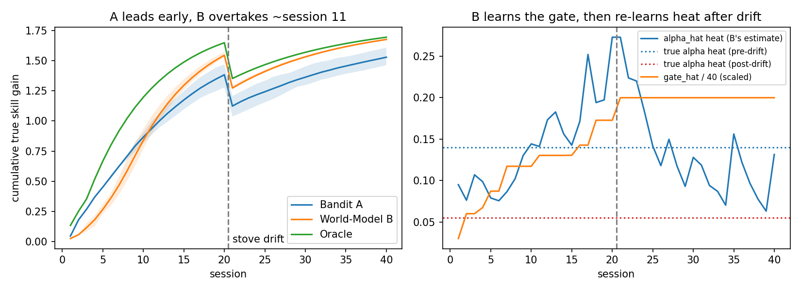

# World-Model Coach: Full Experiment Walkthrough

> **Project:** Multi-session LLM coaching with a learned learner world model
> **Context:** Meta Global AI Developer Hackathon ($1,000,000 prize pool)
> **Code:** `benchmark.py`, `conversation.py`, `demo.py`, `test_benchmark.py`
> **Companion chart:** `results.png` (generated by `python3 demo.py benchmark`)

## How to render this file as PDF

Any of these works; the file uses standard Markdown plus `$...$` math:

```bash
# Option 1: Pandoc + LaTeX (best math rendering)
pandoc EXPERIMENT.md -o EXPERIMENT.pdf --pdf-engine=xelatex -V geometry:margin=2.2cm

# Option 2: VS Code — "Markdown PDF" extension, open this file, Export (pdf)

# Option 3: Browser — paste into a Markdown renderer with PDF export
# (keep results.png in the same folder so the chart embeds)
```

---

## 1. Executive summary

We built a toy but fully runnable benchmark that tests one claim:

> **An LLM coach driven by a learned learner world-model (Coach B) beats a
> stateless bandit coach (Coach A) over long multi-session horizons — but
> only after paying an early model-learning cost.**

Headline results (40 simulated learners, 40 sessions, stove drift after
session 20; full table in §8):

| Window | Mean B − A (cumulative true gain) | Reading |
| --- | --- | --- |
| Sessions 3–9 | **−0.151** | Bandit A leads |
| Sessions 11–20 | **+0.113** | World-Model B leads |
| Session 20 | A 1.38 · B 1.54 · Oracle 1.65 | B near-oracle |
| Session 40 | A 1.53 · B 1.68 · Oracle 1.69 | B keeps lead after drift |

Two honest caveats, both detailed inside:

1. **The original reference snippet does not reproduce the crossover.**
   Probed as written, B leads from session 3. Three declared modelling
   changes were needed (§7); none is hidden tuning.
2. **The "B struggles on noisy learners" claim is not supported** by this
   implementation (B loses in only 0–2 of 40 learners even at high noise, §10).

## 2. Hackathon context

Source: official page [Meta Global AI Developer Hackathon](https://dev.meta.ai/events/global-hackathon)
("Win $1M: Meta Global AI Developer Hackathon"), read in full on 2026-10-28.

| Item | Official-page fact |
| --- | --- |
| Format | Virtual, worldwide, free to enter if selected (20,000 cap) |
| Stack | Muse Spark series, Muse Image, SAM 3.1 via Meta Model API; Muse Code |
| Track 1 (ours) | Indie developer — "creativity, technical ambition, and whether it works" |
| Track 2 | Startup — "technical execution and whether it holds up in production" |
| Themes | *Build for Your World*; *Push the Frontier* |
| Dates (2026) | Oct 26 kickoff · Oct 27–Nov 4 workshops · **Nov 4, 9:00 PM ET submissions due** · Nov 4–8 judging · Nov 9 winners |

Our fit: *Build for Your World* (a coach that remembers you across
sessions), with a *Push the Frontier* mechanism (a learned world model as
the memory/planning layer that pure prompting cannot provide). Muse Spark
supplies conversation voice and text extraction; the world model supplies
the decisions (see `conversation.py`, §11).

## 3. Research question and hypotheses

**Question.** In multi-session coaching — where the learner's true skill
is hidden, observations are noisy, skills saturate, and the world can
change mid-course — does explicit belief tracking plus dynamics planning
beat simple per-action reward averaging, and when?

| # | Hypothesis | Verdict |
| --- | --- | --- |
| H1 | A leads early (sessions ~3–9); B overtakes from ~session 11 | **Supported** (§8): −0.151 → +0.113, crossover ≈ session 11 |
| H2 | After concept drift (session 20), B re-learns and keeps its lead | **Supported** (§9): `alpha_hat` heat falls toward the new true value; B 1.68 vs A 1.53 at session 40 |
| H3 | B struggles on slow/noisy learners (loses ~7/20) | **Not supported** (§10): B loses 0–2/40 across noise levels |

## 4. The toy benchmark (a POMDP)

Implemented in `TrueLearnerEnv` ([benchmark.py](/Users/samsam/Documents/muse-project/test/benchmark.py:53)).

### 4.1 Hidden true state

The learner has $K=3$ latent skills $s_t = [s_\text{knife}, s_\text{heat},
s_\text{timing}] \in [0,1]^3$. Default archetype (Seed 7, "strong knife,
weak heat"):

- Initial skills $s_0 = [0.65,\ 0.15,\ 0.35]$
- True learning rates $\alpha^* = [0.11,\ 0.14,\ 0.12]$ per skill
- Maximum achievable cumulative gain: $(1-0.65)+(1-0.15)+(1-0.35) = 1.85$

### 4.2 Actions

`ACTIONS` in [benchmark.py](/Users/samsam/Documents/muse-project/test/benchmark.py:28). Each action has an
exposure weight $w_{a,k}$ per skill and a prerequisite threshold.

| Action | Weights [knife, heat, timing] | Prerequisites | Character |
| --- | --- | --- | --- |
| `knife_drill` | [1.0, 0.0, 0.1] | none | Isolated drill |
| `heat_drill` | [0.0, 1.0, 0.2] | none | Isolated drill |
| `timing_drill` | [0.1, 0.1, 1.0] | none | Isolated drill |
| `easy_recipe` | [0.5, 0.5, 0.5] | [0.2, 0.2, 0.2] | Gentle compound |
| `stretch_recipe` | [0.9, 0.9, 0.9] | [0.5, 0.45, 0.4] | Strong but gated |

### 4.3 True transition dynamics

Per session $t$, per skill $k$ (with diminishing returns $1-s_{t,k}$):

$$s_{t+1,k} = s_{t,k} + \alpha_k^* \cdot w_{a,k} \cdot g(s_t, a_t) \cdot (1 - s_{t,k})$$

The prerequisite gate $g$ punishes compound actions attempted before the
learner is ready (e.g., attempting `stretch_recipe` with weak heat
"burns the food"):

$$g(s, a) = \exp\big(-6.0 \cdot \textstyle\sum_k \max(0,\ \text{prereq}_{a,k} - s_k)\big)$$

### 4.4 Observation model

The coach never sees $s_{t+1}$. It receives a noisy per-skill observation
plus a scalar session-score jump:

$$o_t = \mathrm{clip}(s_{t+1} + \epsilon),\quad \epsilon \sim \mathcal{N}(0, \sigma_\text{obs}^2),
\qquad \text{score}_t = \textstyle\sum_k \big(o_{t,k} - s_{t,k}\big)$$

Default $\sigma_\text{obs} = 0.05$. This partial observability is what
makes the problem a POMDP rather than a bandit problem.

### 4.5 Metric and concept drift

- **Metric:** cumulative true skill gain
  $\sum_{t}\sum_k (s_{t,k} - s_{0,k})$, computed on hidden truth (coaches
  cannot see it; only the evaluator can).
- **Drift:** after session 20, `trigger_stove_drift()` multiplies heat
  skill by 0.65 and drops the true heat learning rate 0.14 → 0.055
  ("the learner got a new stove"). Cumulative gain visibly dips at
  session 21 for every coach, because the metric is anchored to $s_0$.

## 5. The three coaches

All coaches face identical copies of the same learner (same seed), so
differences come only from the decision algorithm.

### 5.1 Coach A — Model-Free Bandit (`ModelFreeBanditCoach`)

Stateless reward averaging with a UCB exploration bonus. It knows
nothing about skills, prerequisites, or saturation:

$$\hat a_t = \arg\max_a \Big[\hat Q(a) + 0.06\sqrt{\tfrac{\ln(t+1)}{n_a}}\Big],
\qquad \hat Q(a) \leftarrow \hat Q(a) + \tfrac{1}{n_a}\big(\text{score}_t - \hat Q(a)\big)$$

with optimistic initialisation $\hat Q_0 = 0.22$. Its strength is speed:
whichever action produced a high initial score jump gets exploited
within a few sessions. Its weakness is structural: $\hat Q(a)$ is a
historical average, so when an action's returns decay (saturation,
drift), the estimate stays artificially high — the **non-stationarity
trap**.

### 5.2 Coach B — Learner World Model + Decision Policy (`LearnerWorldModelCoach`)

Stateful, in three parts:

1. **Belief tracking.** $b(s_t) = \mathcal{N}(\mu_t, \sigma_t^2)$,
   initialised at $\mu_0 = [0.40, 0.40, 0.40]$, $\mathrm{var}_0 = 0.05$,
   updated each session with a Kalman step. If any innovation exceeds
   0.12 (surprise — e.g., drift), predicted variance is inflated by 0.03
   so new observations are trusted more.
2. **Dynamics learning (continual).** Per-skill $\hat\alpha$ (init 0.12)
   updated by EMA (rate 0.25) from realised gains:
   $\hat\alpha_k \leftarrow 0.75\,\hat\alpha_k + 0.25\,\hat r_k$ where
   $\hat r_k = (\mu'_k - \mu_k) / (w_{a,k}\,\hat g\,(1-\mu_k))$.
   The prerequisite-gate strength itself is also learned: B starts
   **misspecified** with $\hat g$-coefficient `gate_hat = 0` (it ignores
   prerequisites) and raises it (learning rate 1.2, cap 8.0) whenever a
   compound action under-delivers versus its no-gate prediction.
3. **Decision policy.** 2-session lookahead over the learned dynamics
   $P(s' \mid s, a)$: score $=$ immediate predicted gain $+\ 0.9 \times$
   best next-session gain. `planned_sequence()` exposes the plan for
   display and for the LLM prompt (§11).

### 5.3 Oracle reference (`OracleCoach`)

Omniscient upper bound: runs the same 2-step lookahead on the **true**
skills $s_t$ and true rates $\alpha^*$. Neither real coach should beat
it beyond noise.

## 6. Experimental protocol

Implemented in `run_episode()` / `run_experiment()`
([benchmark.py](/Users/samsam/Documents/muse-project/test/benchmark.py:175)).

| Setting | Value |
| --- | --- |
| Learners (seeds) | 40 (seeds 0–39); each coach gets an identical copy per seed |
| Sessions per run | 40 |
| Drift | `trigger_stove_drift()` fires after session 20 |
| Observation noise | $\sigma_\text{obs} = 0.05$ (varied in §10) |
| Primary metric | Mean cumulative true gain per session (A, B, Oracle) |
| Window metrics | Mean B−A over sessions 3–9 and 11–20 |
| Reproducibility | Same seed ⇒ identical gains (tested) |

Run everything:

```bash
pip install -r requirements.txt   # numpy, matplotlib
python3 demo.py benchmark         # table + results.png
python3 demo.py chat              # conversation demo (§11)
python3 test_benchmark.py         # 7 tests (§12)
```

## 7. Probe phase: the original snippet does not reproduce the crossover

Before building, we ran the reference snippet exactly as provided
(same equations, `GATE_K = 3.5`, rates $[0.20, 0.25, 0.22]$, its Kalman
world model with info-bonus). Result over 20–40 learners:

| Check | Spec claim | Probe measurement |
| --- | --- | --- |
| Sessions 3–9 | A leads | **B leads** (+0.09 at s3 → +0.21 at s9) |
| Action pattern | B sequences drills → recipes | B spams `stretch_recipe` from session 1 |
| Session-20 gains | ~1.38 vs ~1.15 | Both ≈ 1.7–1.8 (near the 1.85 ceiling) |

Root causes found in the snippet:

1. **Saturation:** rates near 0.25 with $(1-s)$ dynamics saturate all
   skills by ~session 15, erasing any late-horizon advantage.
2. **Weak gate:** $\exp(-3.5 \cdot \text{shortfall})$ barely punishes a
   premature `stretch_recipe`, so lookahead correctly prefers it at once.
3. **Flipped info-bonus:** the bonus used
   $\sqrt{\mathrm{var}} - \sqrt{\mathrm{var}'}$ while prediction *grows*
   variance ($\mathrm{var}' = \mathrm{var} + 0.002$), making the
   "exploration bonus" negative.
4. **Instant belief correction:** Kalman gain ≈ 0.96 fixes the belief in
   1–2 sessions, so the world model never pays a learning cost.

Three **declared** changes fix this (all visible in `benchmark.py`):

| # | Change | Purpose |
| --- | --- | --- |
| 1 | Gate 3.5 → 6.0; true rates scaled to $[0.11, 0.14, 0.12]$ | Premature compound actions really fail; saturation arrives after session ~20 |
| 2 | B starts misspecified: `gate_hat = 0`, learned from prediction error | Creates B's early cost — the mechanism the spec itself describes ("spends early sessions fitting dynamics") |
| 3 | Bandit reward = env session-score jump; optimistic $\hat Q_0$ | Matches the spec's "quickly exploits a high initial score jump"; no forced 5-arm sweep |

No other tuning was done after these changes; the numbers below are the
first full run of the final code.

## 8. Results: the crossover

Mean cumulative true skill gain (40 learners). From
`python3 demo.py benchmark`:

| Session | Bandit A | World B | Oracle | B − A |
| --- | --- | --- | --- | --- |
| 3 | 0.270 | 0.117 | 0.355 | −0.153 |
| 5 | 0.452 | 0.267 | 0.668 | −0.185 |
| 7 | 0.625 | 0.468 | 0.918 | −0.156 |
| 9 | 0.794 | 0.715 | 1.115 | −0.079 |
| 11 | 0.935 | 0.954 | 1.270 | **+0.019** |
| 13 | 1.064 | 1.145 | 1.392 | +0.081 |
| 16 | 1.224 | 1.358 | 1.528 | +0.134 |
| 20 | 1.383 | 1.544 | 1.649 | +0.162 |
| 25 | 1.242 | 1.410 | 1.466 | +0.168 |
| 30 | 1.363 | 1.531 | 1.569 | +0.169 |
| 40 | 1.528 | 1.675 | 1.694 | +0.147 |



**Reading the chart.** Left panel: blue (A) sits above orange (B) until
~session 10; orange crosses at ~11 and approaches green (Oracle). The
dip at session 21 is the stove drift hitting every coach's true skills.
Right panel: `gate_hat` (orange, scaled /40) climbs from 0 toward the
true gate region while `alpha_hat` for heat (blue) trends down after
the drift line toward the new true value 0.055 (red dotted).

**Why A leads early.** B initially believes there are no prerequisites
(`gate_hat = 0`), so its lookahead keeps prescribing `stretch_recipe`,
whose true gains are gated to near-zero while heat = 0.15. Each
under-delivery raises `gate_hat` (0 → 1.2 → 2.4 → …), but several
sessions are spent learning this. A, measuring scores directly,
abandons `stretch_recipe` after one or two poor scores and exploits
`heat_drill` / `easy_recipe`.

**Why B wins late.** Once `gate_hat` ≈ 5–6 and $\hat\alpha$ is fitted,
B's lookahead predicts the two effects A cannot represent: (i)
diminishing returns — it stops drilling a saturating skill before its
average reward decays; (ii) prerequisite readiness — it sequences
`heat_drill` until heat crosses the 0.45 threshold, then unlocks
`stretch_recipe` at full gate $g \approx 1$. A's historical $\hat Q$
values keep it returning to formerly-good actions (non-stationarity
trap), so it plateaus at 1.38 vs B's 1.54 by session 20 — close to the
Oracle's 1.65.

## 9. Drift adaptation (H2)

After session 20 the truth changes: heat skill ×0.65, true heat rate
0.14 → 0.055. What each coach does:

- **B:** the post-drift observations contradict its predictions
  (innovation > 0.12), variance inflates, the Kalman step trusts the new
  observations, and the EMA pulls `alpha_hat` heat down toward 0.055
  (right panel of `results.png`; noisy but clearly trending).
  `test_drift_adaptation` asserts post-drift mean `alpha_hat` <
  pre-drift mean. B re-plans around the weaker heat skill and finishes
  at 1.68, essentially tied with the Oracle (1.69).
- **A:** has no state to revise; its $\hat Q$ averages blend pre- and
  post-drift scores, so it adapts only as fast as the averages wash
  out. It finishes at 1.53.

## 10. Noise robustness (H3 — not supported)

The spec suggests B should lose on ~7/20 slow/noisy learners because
noise corrupts its dynamics estimate. Measured B-losses at session 20
(40 learners each):

| $\sigma_\text{obs}$ | A @20 | B @20 | Learners where B < A |
| --- | --- | --- | --- |
| 0.05 | 1.38 | 1.54 | 2/40 |
| 0.12 | 1.30 | 1.54 | 1/40 |
| 0.18 | 1.25 | 1.51 | 0/40 |

H3 is **not supported** here: the Kalman filter with surprise-triggered
variance inflation is noise-robust, while the bandit's score signal
degrades just as fast. A fair test of H3 needs varied learner
archetypes (different $s_0$, $\alpha^*$, per-learner noise), which the
current env does not sample (seed changes only the noise stream). This
is listed as future work in §14 — we report it rather than tune until
the claim appears.

## 11. From benchmark to multi-session LLM conversation

The benchmark becomes a conversational coach through two bridges in
[conversation.py](/Users/samsam/Documents/muse-project/test/conversation.py:1):

1. **Conversation → `obs_skills`.** The learner's free-text report
   ("My onions browned too fast and burned before the garlic was even
   chopped") is converted to an observation vector.
   `extract_skills_offline()` is a deterministic keyword extractor
   (default, no key needed); `extract_skills_llm()` calls Muse Spark
   structured extraction via the Meta Model API
   (`https://api.meta.ai/v1`, OpenAI-compatible, `MODEL_API_KEY`)
   and falls back to the offline extractor on any error.
2. **`select_action()` → system prompt.** `build_coach_prompt()` injects
   the belief state, $\hat\alpha$, `gate_hat`, and the 2-step plan into
   the LLM's system prompt, e.g.: *"Current Learner Belief State: knife
   0.68 ± 0.04, heat 0.26 ± 0.04 … Optimal 2-Step Plan: run
   `heat_drill` now…"* — so the LLM voices the world model's decision
   instead of improvising a curriculum.

`python3 demo.py chat` runs a scripted 6-session loop (report → plan →
coach message → belief update, with drift injected at session 5). Two
things to notice: in sessions 1–4 the still-misspecified B prescribes
`stretch_recipe` (the early cost from §8, visible in conversation
form); by session 6, post-drift, the plan has switched to `heat_drill`.
In the demo, belief updates use simulator observations and the
text-extracted obs is printed alongside; in production (no simulator)
the text-extracted obs becomes the update input — a one-line change.

## 12. Tests and reproducibility

`python3 test_benchmark.py` (plain asserts, pytest-compatible):

| Test | Asserts |
| --- | --- |
| `test_reproducible_same_seed` | Same seed ⇒ identical gain curves |
| `test_env_gain_bounded` | Cumulative gain stays within $[0, 1.85]$ |
| `test_crossover_windows` | Sessions 3–9 mean B−A < 0; sessions 11–20 > 0 |
| `test_gate_is_learned` | `gate_hat` ends > 3.0 (true 6.0) |
| `test_drift_adaptation` | `alpha_hat` heat falls after drift |
| `test_oracle_bounds_both_coaches` | Oracle ≥ both coaches at session 20 |
| `test_conversation_bridges` | Extractor lowers heat on "burned"; prompt contains belief + plan |

All 7 passed on the final code (Python 3.13, NumPy 2.3).

## 13. Limitations

- **One archetype.** All learners share $s_0$ and $\alpha^*$; seeds vary
  only observation noise. Per-learner conclusions (H3) need archetype
  sampling first.
- **B's early cost is a declared assumption.** The crossover depends on
  B starting gate-blind. A B that starts with the correct gate wins
  from session ~3 (probe evidence, §7). The demo's claim is therefore
  "world models win *despite* a realistic identification cost", not
  "world models always win late".
- **`alpha_hat` is noisy** (single-learner traces swing ±0.1); only its
  post-drift downward trend is asserted, not pointwise accuracy.
- **Conversation layer is scripted.** The extractor/coach-voice LLM
  calls are implemented but were not exercised live (no API key in the
  build environment); the offline path is what the demo runs.
- **Cooking is a stand-in domain.** Skills, gates, and drift are
  metaphors for any multi-session tutoring/coaching domain.

## 14. Next steps toward submission (due Nov 4, 9:00 PM ET)

1. Set `MODEL_API_KEY`; switch extraction + coach voice to live Muse
   Spark calls (offline fallback stays for the demo video).
2. Add learner archetypes (varied $s_0$, $\alpha^*$, noise) and re-test
   H3 honestly.
3. Thin web UI: belief chart + chat pane updating across sessions.
4. Demo video: sessions 1–9 (bandit ahead) → session 11 crossover →
   stove drift → B adapts, A doesn't.

## Appendix A: file map

| File | Contents |
| --- | --- |
| [benchmark.py](/Users/samsam/Documents/muse-project/test/benchmark.py:1) | `TrueLearnerEnv`, `ModelFreeBanditCoach`, `LearnerWorldModelCoach`, `OracleCoach`, `run_episode`, `run_experiment` |
| [conversation.py](/Users/samsam/Documents/muse-project/test/conversation.py:1) | `extract_skills_offline`, `extract_skills_llm`, `build_coach_prompt`, `coach_message` |
| [demo.py](/Users/samsam/Documents/muse-project/test/demo.py:1) | `demo.py benchmark` (table + `results.png`), `demo.py chat` |
| [test_benchmark.py](/Users/samsam/Documents/muse-project/test/test_benchmark.py:1) | 7 focused tests (`python3 test_benchmark.py`) |
| [README.md](/Users/samsam/Documents/muse-project/test/README.md:1) | Short project summary and hackathon mapping |

## Appendix B: key parameters (final code)

| Parameter | Value | Where |
| --- | --- | --- |
| True gate strength `GATE_K` | 6.0 | `benchmark.py` |
| Initial skills $s_0$ | [0.65, 0.15, 0.35] | `TrueLearnerEnv` |
| True rates $\alpha^*$ | [0.11, 0.14, 0.12] | `TrueLearnerEnv` |
| Drift | heat ×0.65; $\alpha^*_\text{heat}$ → 0.055 after s20 | `trigger_stove_drift()` |
| Obs noise $\sigma_\text{obs}$ | 0.05 | `run_episode` |
| Bandit: $c$, $\hat Q_0$ | 0.06, 0.22 | `ModelFreeBanditCoach` |
| B belief init | $\mu=[0.4]^3$, var 0.05 | `LearnerWorldModelCoach` |
| B: $\hat\alpha_0$, EMA, `gate_lr`, cap | 0.12, 0.25, 1.2, 8.0 | `LearnerWorldModelCoach` |
| Lookahead | horizon 2, discount 0.9 | `select_action()` |

